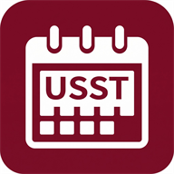

# USST 教务与课程门户 Android 客户端 (`usst-jwgl-client`)

  

  基于 Material Design 3 开发的上海理工大学教务与课程学习 Android 原生客户端。

  
  
  
  
  

---

## 📖 项目简介

**usst-jwgl-client** 是一个面向上海理工大学师生的第三方 Android 原生客户端，使用 Kotlin 与 Material Design 3 组件构建，直接对接学校教务系统、统一身份认证（CAS）SSO、一网畅学（TronClass）及超星学习通接口，提供课表管理、成绩与学分查询、课程学习门户、空教室检索与桌面微件等常用功能。

所有网络请求与数据存储均在本地设备完成，应用本身不设外部中转服务器。

---

## ✨ 主要功能

### 1. 课程门户（一网畅学 + 超星学习通）
- **双平台聚合与切换**：支持同时接入一网畅学（TronClass）与超星学习通，可通过顶栏按钮在「纯畅课」与「双平台」模式间切换；支持孤立课程手动绑定、解绑与学期归类。
- **原生课程详情**：在一个界面内集中查看待办作业、课程公告、章节课件、测验考试、课堂讨论（`forum`）与班级成员列表。
- **作业与测验支持**：
  - 支持在原生页面查看题目要求、一键复制题干，支持拍照上传或选择本地文件作为作业附件；重新提交时自动处理撤回与再次提交。
  - 支持超星客观题原生答题、学习通网盘附件上传与成绩/评语解析。
  - 内置基于 Android `PdfRenderer` 的原生 PDF 阅读器，支持常见文档预览与附件下载。
- **课堂签到与提醒**：
  - 支持畅课（扫码、数字口令、GPS/雷达定位、自主签到）及超星（二维码、手势、拍照、位置选点）多种签到方式，基于 Google ML Kit + CameraX 实现离线扫码。
  - 内置教学楼基准坐标与自动吸附逻辑，支持免无障碍权限的课堂签到提醒与通知直达。
- **作业截止提醒 (DDL Guard)**：支持 24 小时前与临期 1~3 小时两级提醒配置，通过 `WorkManager` 与 `AlarmManager` 在后台调度唤醒。

### 2. 智能课表与日程管理
- **新老作息表自动适配**：按学期自动切换 12 节旧作息表（2025-2026-2 及之前）与 13 节新作息表（2026-2027-1 起），每日同步校历开学日期与放假调休安排。
- **多周次与冲突处理**：支持周次切换、仅看本周课程筛选、重叠冲突课程并排显示；支持手动添加临时课程、单次停课及**课程锁定**（同步教务课表时保留锁定课程）。
- **实验课表导入**：支持导入教务/实验系统导出的 `.xlsx`、`.csv`、HTML 表格及 `.xls` 文本表，自动处理 UTF-8 BOM 头、日期换算周次节次与重复时段合并，并与教务课表数据隔离存储。
- **课表与学习进度联动**：点击课程详情可同步展示对应的课程门户学习进度与最近截止待办，并支持跳转课程直播/点播回放页面。

### 3. 全校课表与空教室查询
- **全校课表离线检索**：首次拉取后持久化至本地 JSON 与内存缓存，支持按学期、培养层次（本科生/研究生）、学院、时段、星期、周次、教师及课程名进行离线组合筛选，并可将任意教学班加入个人课表。
- **空教室排查**：覆盖校内 9 大主要教学楼共 396 间常规教室（一教、三教、四教、卓越楼、国合楼、综合楼、博学楼、乐学楼、勤学楼），依据当前教学周实际排课判定占用，并对常见教学楼别名做归一化处理。

### 4. 学业成绩与学分节点
- **成绩与绩点统计**：支持按全部或指定学期查看课程成绩，计算加权平均分与 GPA（自动对重修、补考课程去重）。
- **学分节点视图**：支持在学期视图与学分节点层级树间切换（平板横屏支持左右双栏独立滚动与学分进度条展示），支持替代课程状态标记。
- **排名解析与报表导出**：内置无外部依赖的 CID-CMap PDF 字符流解码器，用于解析教务系统导出的班级/专业/年级排名文件，并支持生成和分享本地成绩报表 PDF。

### 5. 桌面微件（AppWidget）
- 提供**今日课表**与 **2×2 下一节课倒计时**两种桌面微件，支持在微件内直接翻页查看日期、跳转一键签到及显示待交作业提示。
- 提供微件外观自定义与双形态实时预览页面，支持调整颜色风格（自动/浅色/深色/透明）、卡片透明度及展示字段过滤。

### 6. 账号认证与官方系统直通
- **登录与防验证码通道**：原生直连 CAS 统一身份认证；当触发图片验证码或滑块风控时，可切换至内置官方 SSO 网页登录并自动预填账密、同步 Cookie 至原生客户端。
- **官方系统直通车**：内置教务系统（`jwgl`）、学工一体化（`new2017`）与课程直播/点播（`live`）入口，通过通用 CAS SSO 预认证实现免重复登录跳转，并适配全面屏状态栏安全边距。
- **多账号隔离**：按学号独立隔离课表数据库、本地缓存与畅课设备标识，切换账号时自动刷新各平台会话。

---

## 🔒 安全与隐私说明

| 模块 | 实现方式 |
| :--- | :--- |
| **本地凭据加密** | 使用 Jetpack `EncryptedSharedPreferences` + Android Keystore（AES-256 SIV/GCM）加密存储账号与会话凭据；退出登录时清理本地凭据与业务缓存。 |
| **网络传输限制** | 默认禁止明文 HTTP（`cleartextTrafficPermitted="false"`），仅对尚未启用 HTTPS 的 `*.usst.edu.cn` 校内历史域名保留白名单；OkHttp 拦截器校验目标域名白名单，防止会话凭证外泄。 |
| **CAS SSO 校验** | 限制官方认证域名（`ids6.usst.edu.cn`、`ids6-443.webvpn.usst.edu.cn`）与 `/authserver/login` 路径前缀，拦截异常跳转。 |
| **WebView 与存储隔离** | Release 构建关闭 WebView 调试并禁用混合内容；`FileProvider` 仅暴露下载、上传暂存与报表等私有子目录，禁用系统自动备份（`allowBackup="false"`）。 |
| **纯本地运行** | 本项目为开源学习工具，不收集、不上传任何个人数据至第三方或开发者服务器。 |

---

## 🛠️ 技术栈

- **语言与并发**：Kotlin 2.0+、Kotlin Coroutines
- **平台兼容**：Android 7.0+（API 24 ~ 36），`arm64-v8a`
- **UI 组件**：Material Design 3、ViewBinding、CoordinatorLayout、BlurView
- **系统调度**：Jetpack Lifecycle、WorkManager、AlarmManager
- **网络与解析**：OkHttp 4.12、Jsoup 1.17、Gson 2.10
- **扫码与文档**：Google ML Kit Barcode Scanning、CameraX 1.3.4、Android `PdfRenderer` + 自研 CID-CMap 解码器
- **安全存储**：AndroidX Security Crypto

---

## 📝 版本更新历史 (Changelog)

### v1.3.2 (2026-11-28)
- **设置页重构**：重构「我的与设置」为分组卡片式列表，支持个人档案折叠展开与平板双栏自适应，精简设置与提示文案。
- **课件自定义存储与多媒体增强**：新增课件/附件存储管理（支持系统下载目录、应用私有目录与自定义 SAF 文件夹及按课程归档）；完善超星附件原生下载与类型识别，视频播放器支持备用线路切换与下载到本地，内置 PDF 阅读器新增保存至下载目录与规范分享命名。
- **课堂提醒与课表管理**：新增学习通课堂签到低频轮询提醒与悬浮横幅/强弹窗双模式提醒，修复弹窗扫码回调；课表管理新增下学期条目并保持本学期默认选中。
- **性能与稳定性**：本地课表数据库开启 SQLite WAL 模式提升读写并发性能，补充存储、设置页与附件解析等单元测试覆盖。

### v1.3.1 (2026-11-26)
- **多形态桌面微件扩展**：新增「学习动态（近 7 天待办与通知）」与「全能校园（课表/待办/通知多合一）」桌面微件，支持组件内 Tab 切换、日期翻页与可配置的后台定时同步。
- **课堂提醒与 Android 14+ 权限优化**：修复锁屏全屏签到提醒弹窗时序与息屏轮询休眠问题，完善 Android 14+ 通知与悬浮窗权限诊断页，优化定位回调与异常兜底处理。
- **课程直播与多账号隔离加固**：修复直播接口日期与灵活字段解析兼容问题及流处理潜在崩溃；跨账号切换时全面隔离直播 Token、WebView Cookie、本地缓存与提醒任务。
- **门户体验与底层架构重构**：完善课程活动多附件查看与下载弹窗，优化主页列表差异刷新；对网络层、数据库 DAO 与核心 UI 控制器完成模块化拆分并补充单元测试覆盖。

### v1.3.0 (2026-11-19)
- **课程门户双平台融合**：接入超星学习通（CAS SSO 静默认证、机构登录、会话检查），支持顶栏切换「纯畅课 / 双平台」模式、孤立课程手动绑定与学期分配；统一原生课程详情与作业提交，支持客观题原生答题、学习通网盘附件上传与内置原生 PDF 阅读器。
- **课堂签到与提醒升级**：覆盖畅课与超星全类型签到并聚合考勤历史；更新全校 22 栋教学楼基准坐标与 GCJ-02 校准，默认使用本机硬件定位；新增免无障碍权限的课堂签到强提醒弹窗与权限诊断页，签到向导重构为 BottomSheet。
- **桌面微件重构**：融合待交作业提示与一键签到入口，新增 2×2「下一节课倒计时」微件、日期翻页与外观自定义预览页面。
- **成绩学分节点与平板适配**：新增学分节点视图与替代课程徽章，平板横屏支持左右双栏独立滚动，修复重修/补考课程在累积 GPA 计算中的重复问题。
- **课表与全校课表增强**：支持锁定自定义课程防覆盖、快捷添加未排课课程；修复往期学期查询限制、分页索引偏移与空响应污染缓存问题。
- **界面整理、安全与性能**：重构「更多功能」为 Bento Grid 布局，默认采用底栏导航；统一清理冗余 Emoji 与阻塞弹窗，引入高级调试模式管控进阶功能；优化冷启动速度与多账号数据库/缓存隔离，修复跨版本覆盖升级的旧缓存空指针与冷启动学期定位问题。

### v1.2.2 (2026-10-28)
- 重构一网畅学主页为「待办作业 / 课程公告 / 在修课程」三列 Tab，课程详情页新增「课堂讨论」与「班级成员」底部弹窗，签到活动合并至顶部卡片。
- 修复官方教务系统、学工一体化与课程直录播平台的 CAS SSO 静默预认证。
- 新增上课时段后台签到监听、校园雷达点位匹配及多账号独立设备码隔离；优化深色模式对比度与页面切换预热。

### v1.2.1 (2026-10-25)
- 新增「官方 SSO 页面登录」通道以应对校园网图片验证码与滑块风控，支持账密预填与会话同步。
- 修复全面屏状态栏 WindowInsets 遮挡问题；移除 `zxing-android-embedded` 依赖，统一由 ML Kit 负责扫码。
- 优化作业详情下拉刷新避让、新增拍照提交附件与一键复制题目要求；合并重新提交作业流程为单次点击。
- 全局默认禁用明文 HTTP，畅课凭据升级为硬件加密存储，生产构建收窄 `FileProvider` 与 WebView 权限，精简包体仅保留 `arm64-v8a`。

查看更早版本 (v1.2.0 ~ v1.1.2)

- **v1.2.0 (2026-10-25)**：一网畅学原生重构、DDL 二级提醒、冲突课程并排渲染、学业排名查询与平板横屏双栏适配。
- **v1.1.4 (2026-10-16)**：课程直播/点播联动、桌面与手机 UA 切换、CAS SSO 自动登录与今日课表桌面小部件。
- **v1.1.3 (2026-10-15)**：实验课表导入与修复引擎、全校课表离线缓存检索与 9 大教学楼空教室查询。
- **v1.1.2 (2026-10-12)**：Material 3 界面与双导航模式、平板横屏适配、`EncryptedSharedPreferences` 加密与 R8 混淆签名。

---

## 📥 下载与安装

- **GitHub Releases**：[v1.3.2 Release](https://github.com/BigSilverFish/usst-jwgl-client/releases/tag/v1.3.2)
- **APK 直链**：[app-release.apk (v1.3.2)](https://github.com/BigSilverFish/usst-jwgl-client/releases/download/v1.3.2/app-release.apk)
- **系统要求**：Android 7.0 (API 24) 及以上，`arm64-v8a` 设备。

> **升级提示**：如从 `v1.2.2` 或更早版本升级，建议更新至最新 `v1.3.2` 安装包，已修复跨版本缓存兼容与冷启动学期定位问题。

---

## 👨‍💻 作者与开源协议

- **开发者**：[GitHub@BigSilverFish](https://github.com/BigSilverFish)
- **联系邮箱**：[nicolaszhaoquad@gmail.com](mailto:nicolaszhaoquad@gmail.com)
- **开源协议**：[GNU General Public License v3.0 (GPL v3)](LICENSE)
- **免责声明**：本项目为上海理工大学学生出于技术学习与交流目的独立开发的非官方开源客户端，与学校教务处、信息化办公室及各教学平台无隶属关系。应用不设任何外部数据中转服务器，所有教务、成绩与考勤数据均直接来自官方公开接口，结果以官方平台为准。工具仅用于个人学业查询与防漏签提醒，请勿用于任何违反校纪校规的用途。
